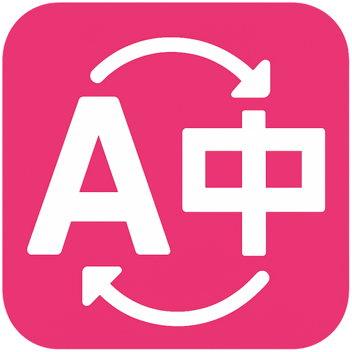
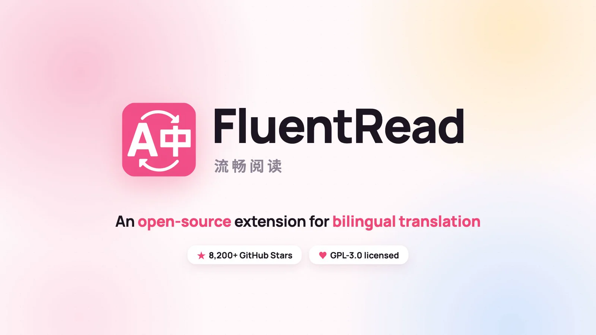
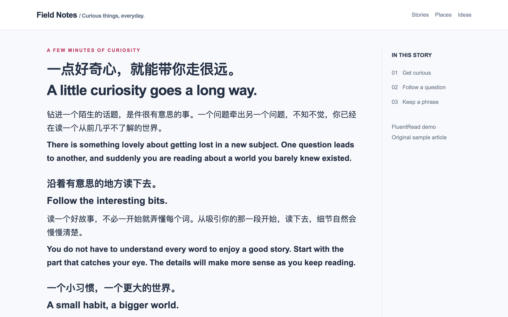

<div align="center">



# FluentRead

**Closer languages. A bigger world.**

An open-source browser extension for bilingual translation.

[Install](#installation) · [Website](https://read.thinkstu.com/en/) · [User guide](https://read.thinkstu.com/en/guide/) · [Sponsorship](#sponsorship) · [Privacy policy](https://read.thinkstu.com/en/guide/privacy) · [简体中文](./misc/README_ZH.md) · [LINUX DO Community](https://linux.do) · [GPL-3.0](./LICENSE)

</div>

FluentRead displays translations alongside the original webpage and provides selection translation, AI reading assistance, image and document translation, and bilingual video subtitles. Its reading card provides contextual explanations and follow-up questions.

<div align="center">

[](https://read.thinkstu.com/videos/fluentread-promo-en.mp4)

[▶ Watch the 56-second introduction](https://read.thinkstu.com/videos/fluentread-promo-en.mp4)

For a closer look, [watch the full official introduction (4+ minutes, in Chinese on Bilibili)](https://www.bilibili.com/video/BV1qhHJ6uEiF/).

</div>

[](./docs/public/screenshots/en/translation.webp)

## Features

| Feature | Description |
| --- | --- |
| Webpage translation | Bilingual page translation, hover and selection translation, original-text restoration, and automatic translation rules. |
| AI reading card | Meaning, sentence analysis, usage explanations, and practice, with paragraph context and follow-up questions. |
| Learning center | Save words, phrases, and sentences with their original context for study and review. |
| Image and area translation | Recognize text in webpage images or selected screen areas and display translations that can be copied. |
| Document translation | Read PDF, ePub, DOCX, and other supported formats in two languages, edit translations, and export files. |
| Video subtitles | Bilingual subtitles on YouTube and X; supported X videos can also use local AI transcription. |
| Services and settings | Free translation services, DeepL, AI providers, and local Ollama models, with glossaries, translation styles, shortcuts, and menu layout settings. |

See the [user guide](https://read.thinkstu.com/en/guide/) for instructions and supported formats. AI explanations require a configured AI service. Third-party pricing and availability depend on the provider.

## Installation

[Chrome](https://chromewebstore.google.com/detail/djnlaiohfaaifbibleebjggkghlmcpcj) · [Edge](https://microsoftedge.microsoft.com/addons/detail/kakgmllfpjldjhcnkghpplmlbnmcoflp) · [Firefox](https://addons.mozilla.org/en-US/firefox/addon/%E6%B5%81%E7%95%85%E9%98%85%E8%AF%BB/) · [Userscript](https://greasyfork.org/en/scripts/482986)

1. Install the extension and refresh the webpage.
2. Open FluentRead and select a target language. The source language defaults to automatic detection and can also be selected manually.
3. Choose “Translate page.” Enable selection translation and other tools in settings as needed.

Store updates may arrive at different times. The userscript provides core webpage translation features. See the [installation guide](https://read.thinkstu.com/en/guide/getting-started) for browser and feature availability.

## Sponsorship

The project is currently funded mainly out of pocket, with tens of thousands of US dollars spent each month on API tokens for open-source development. We believe FluentRead can make the world a little better.

<a href="mailto:a1914493943@gmail.com?subject=FluentRead%20sponsorship"></a>

[Email us](mailto:a1914493943@gmail.com?subject=FluentRead%20sponsorship) · [Add on WeChat](https://read.thinkstu.com/support/wechat-contact.jpg)

## Local development

Requirements: Node.js 20 or later and pnpm 9.

```sh
pnpm install --frozen-lockfile
pnpm dev
```

Use `pnpm build` to build the Chrome extension and `pnpm zip` to generate one `-chrome.zip`, preserving its public key, fixed extension ID, and Google OAuth configuration. Use the same ZIP for manual installation and preparation for an update to the existing Chrome Web Store item. Packaging removes the obsolete `-chrome-store.zip` for the same version. See [extension identity and packages](./docs/maintainers/extension-identity-and-packages.md) for details.

Use `pnpm build:firefox` to build the Firefox extension, `pnpm zip:firefox` to generate its installation and review-source ZIPs, and `pnpm zip:edge` to generate the separate Microsoft Edge Add-ons ZIP without the Chrome `key`. The review-source ZIP includes the extension build inputs; website assets, test evidence, and other distribution targets are omitted. Use `pnpm compile` for type checking and `pnpm docs:build` to build the website. See [architecture](./docs/architecture.md) and [testing](./docs/testing.md) for project conventions.

For Mozilla reviewers, the Firefox build uses Node.js 20 or later, pnpm 9 (the exact pnpm version is pinned in `packageManager`), and the checked-in `pnpm-lock.yaml`. From the source ZIP root, run `pnpm install --frozen-lockfile` followed by `pnpm build:firefox`; the generated extension is in `.output/firefox-mv2`. No private credentials or `.env` file are needed. The build keeps the upstream vendor files intact and applies source-hash-checked CSP adaptations in `scripts/testing/extension-csp-build.ts` and `scripts/wasm/package-diagnostics.ts`. Those transformations are part of the submitted sources and run on every build.

The AMO warning remediation build was checked on macOS ARM64 with Node.js 20.11.1 and pnpm 9.12.1; there are no OS-specific native compilation steps for the extension. Vendored OCR sources and licenses are listed in `public/fluent-read-ocr/NOTICE.md`. The other patched packages and exact versions come from `package.json` and `pnpm-lock.yaml`: Tesseract.js/regenerator-runtime, JSZip, PDF.js, fontkit, lodash-es, and ONNX Runtime Web. Their original files remain available through the official npm packages. The CSP adaptations replace global-object fallbacks with `globalThis`, reject unused string timer callbacks, keep PDF.js on its interpreter, and replace the ONNX Emscripten invoker with a static closure. WASM binaries are unchanged.

Before AMO submission, install Mozilla's validator separately, for example `npm install --prefix /tmp/fluentread-amo-tools --ignore-scripts --no-audit --no-fund addons-linter@10.15.0`, then run `pnpm lint:firefox:amo --linter /tmp/fluentread-amo-tools/node_modules/.bin/addons-linter --report /tmp/fluentread-amo-report.json`. The command checks the built Firefox directory by default; pass the installation ZIP as the first argument to check that exact upload. It preserves the complete report and fails on errors or validator failure. Warnings remain visible for review. Successful local validation does not confirm AMO signing or approval.

Run `pnpm storybook` to explore the real Vue components and interface themes locally. See the [design system guide](./docs/en/guide/design-system.md). Use `pnpm docs:build:site` to build the documentation with the component explorer.

## Contributing

Report bugs and propose changes through [Issues](https://github.com/FluentRead/FluentRead/issues). Pull requests for code, documentation, interface translations, and [website adaptation](./docs/contributing/site-adaptation.md) are welcome.

## Support

FluentRead is an open-source project whose continued development is made possible by the generous support of its community. Voluntary contributions are welcome through either service.

<table>
<tr><th>WeChat Support</th><th>Ko-fi · International</th></tr>
<tr>
<td align="center"><a href="./misc/approve.jpg"></a><br />Scan with WeChat. Click the image to enlarge.</td>
<td align="center"><a href="https://ko-fi.com/thinkstu"><strong>Support thinkstu on Ko-fi ↗</strong></a><br /><br />ko-fi.com/thinkstu</td>
</tr>
</table>

## Acknowledgments

FluentRead grows alongside a vibrant open-source community. We are grateful to the following projects and their contributors for their openness and generosity:

- [Read Frog](https://github.com/mengxi-ream/read-frog)
- [KISS Translator](https://github.com/fishjar/kiss-translator)
- [Duo Translator](https://github.com/linuxscreen/duo-translator)
- [InfoLens](https://github.com/dqy08/InfoLens) — Smart Highlighting is inspired by its surprisal heatmap idea (Apache-2.0)

<!-- contributors:start -->
<a href="https://github.com/FluentRead/FluentRead/graphs/contributors">
  <table>
    <tr>
      <th>
        <br>
        <br>
        <br>
      </th>
    </tr>
  </table>
</a>
<!-- contributors:end -->

Thank you to everyone who has contributed to FluentRead, including the many we couldn't name here, and to every user for embracing a product that is still far from perfect. We hope to keep building together with you, and to bring a little more good into the world.

## License and privacy

FluentRead is released under [GPL-3.0](./LICENSE). See [third-party notices](./public/third-party-notices/) for component attribution and licenses.

Settings and learning records stay local by default; cloud translation uses your selected provider. Optional cloud configuration backup supports Google Drive and [WebDAV](https://read.thinkstu.com/en/guide/webdav), including service credentials while excluding wordbooks, conversations, and usage statistics. See the [privacy policy](https://read.thinkstu.com/en/guide/privacy) for permissions, encryption, and deletion details.
